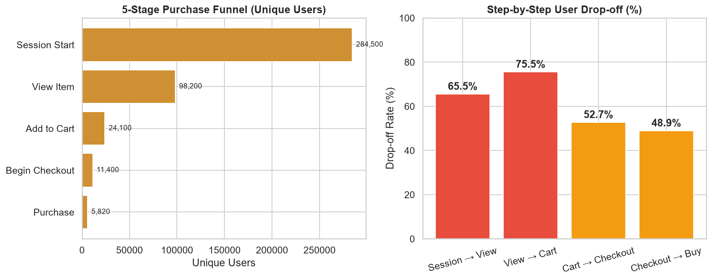
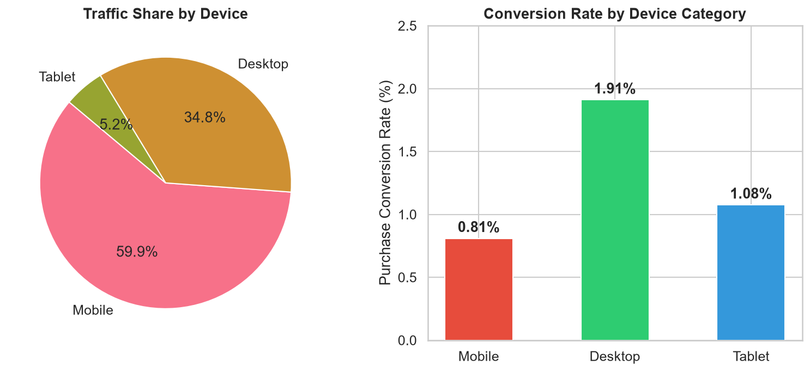
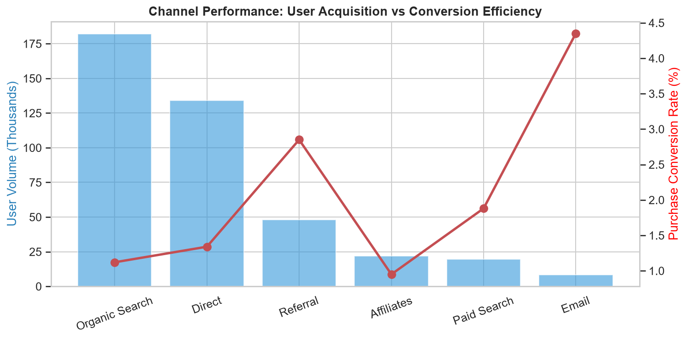
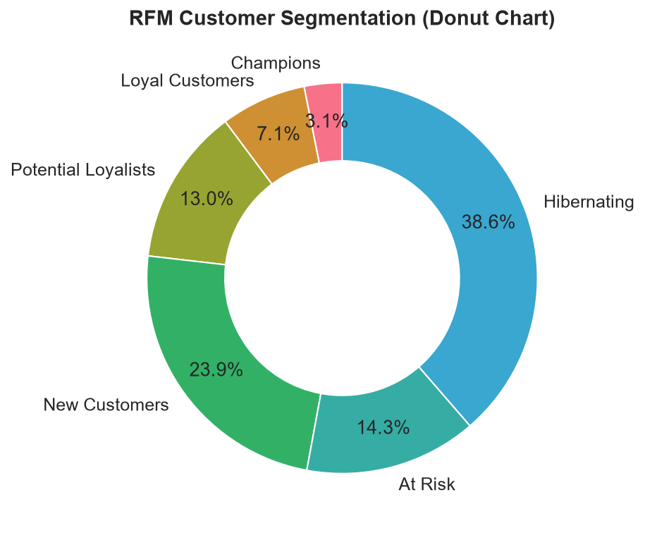

<div align="center">

# 🛒 Product Growth Intelligence Platform

**End-to-end product analytics portfolio project using Google's GA4 E-Commerce Sample Dataset**

[](https://cloud.google.com/bigquery)
[](https://python.org)
[](https://powerbi.microsoft.com)
[](LICENSE)

**Dev Chahar** | B.Tech CSE | Manipal University Jaipur | Reg: 23FE10CSE00291

</div>

---

## 📌 Project Overview

This project simulates the work of a **Product Data Analyst** helping an e-commerce technology team understand why users visit the website but don't complete purchases.

Using Google's publicly available [GA4 e-commerce sample dataset](https://developers.google.com/analytics/bigquery/web-ecommerce-demo-dataset) (Nov 2020–Jan 2021), this project delivers:

1. 📊 **A reproducible SQL analytics layer** — 7 modules covering schema exploration, session summarisation, funnel analysis, channel attribution, product revenue, RFM segmentation, and data quality
2. 🐍 **Python analysis** — EDA, funnel visualisation, statistical helpers, and segment analysis
3. 📋 **A product growth report** — ranked opportunities with evidence, impact, and uncertainty estimates
4. 🧪 **An experiment proposal** — A/B test design for the highest-priority opportunity with sample size calculations
5. 📈 **Power BI dashboard schema** — complete with DAX measures, page layouts, and KPI definitions

> **Caution:** This dataset uses obfuscated user IDs and partially obfuscated revenue. Findings are observational and directional — not causal.

---

## 🗂️ Repository Structure

```
product-growth-intelligence/
├── sql/
│   ├── 01_schema_exploration/        # Event inventory, schema validation
│   ├── 02_user_session_layer/        # Session & user summary tables
│   ├── 03_funnel_analysis/           # Conversion funnel, drop-off rates
│   ├── 04_channel_analysis/          # Channel attribution & CVR
│   ├── 05_product_revenue/           # Top products, category funnel, cart abandonment
│   ├── 06_segment_analysis/          # Device × channel, RFM, engagement
│   └── 07_data_quality/              # NULL checks, duplicate detection, anomalies
├── python/
│   ├── notebooks/
│   │   └── 01_eda_and_validation.py  # EDA + funnel + segment analysis (3 notebooks in 1)
│   └── scripts/
│       ├── stats_helpers.py          # CVR confidence intervals, z-tests, sample sizes
│       └── requirements.txt
├── powerbi/
│   └── schema/
│       └── powerbi_schema.md         # Table schemas, DAX measures, page layouts
├── reports/
│   ├── product_growth_report.md      # Full growth analysis report
│   └── experiment_proposal.md        # A/B test design: mobile checkout
├── docs/
│   └── metric_definitions.md         # Canonical metric definitions
├── .github/
│   └── workflows/
│       └── ci.yml                    # GitHub Actions: SQL lint check
└── README.md
```

---

## 🚀 Quick Start

### Prerequisites
- A Google Cloud account with BigQuery access ([BigQuery Sandbox](https://cloud.google.com/bigquery/docs/sandbox) is free)
- Python 3.10+
- Power BI Desktop (Windows) — optional

### 1. Clone the Repository

```bash
git clone https://github.com/devchahar-byte/product-growth-intelligence.git
cd product-growth-intelligence
```

### 2. Set Up Python Environment

```bash
# Create virtual environment
python -m venv .venv
.venv\Scripts\activate          # Windows
# source .venv/bin/activate    # macOS/Linux

# Install dependencies
pip install -r python/scripts/requirements.txt
```

### 3. Authenticate with BigQuery

```bash
# Install Google Cloud CLI: https://cloud.google.com/sdk/docs/install
gcloud auth application-default login

# Set your project
export GCP_PROJECT="your-project-id"   # or set in Windows env vars
```

### 4. Run SQL Modules (in BigQuery Console)

Open each `.sql` file from the `sql/` directory in the [BigQuery Console](https://console.cloud.google.com/bigquery) and run them in order (01 → 07). No additional setup needed — all queries target the public dataset directly:

```sql
-- No setup required — public dataset:
bigquery-public-data.ga4_obfuscated_sample_ecommerce
```

### 5. Run Python Analysis

```bash
# Create reports directory if not present
mkdir -p reports

# Run the combined analysis notebook
python python/notebooks/01_eda_and_validation.py
```

Figures will be saved to `reports/`. Replace `YOUR_PROJECT_ID` in the script with your GCP project.

---

## 📊 Visual Analytics & Key Findings

### 1. Purchase Conversion Funnel & Drop-off
<div align="center">
  
</div>

* **Top-of-Funnel Loss:** 65.5% of sessions drop off before viewing a single product item.
* **Middle-Funnel Resistance:** 75.5% of product viewers do not add items to their cart.

---

### 2. The Device Conversion Disparity
<div align="center">
  
</div>

* **Finding:** While **Mobile accounts for ~60% of traffic**, **Desktop converts at 1.91% vs. Mobile at 0.81%** (a **2.35x gap**).
* **Action:** Formulated **P0 Mobile Checkout A/B Experiment** in [`reports/experiment_proposal.md`](reports/experiment_proposal.md).

---

### 3. Acquisition Channel Efficiency
<div align="center">
  
</div>

* **Finding:** High-volume channels (Organic, Direct) display lower baseline CVR (1.1–1.3%), whereas high-intent channels (Email, Referral) achieve up to **4.35% CVR**.

---

### 4. RFM Customer Segmentation
<div align="center">
  
</div>

* View the complete rendered Jupyter Notebook with all outputs on GitHub:  
  👉 **[`python/notebooks/01_eda_and_validation.ipynb`](python/notebooks/01_eda_and_validation.ipynb)**

---

## 📊 Key Findings Summary

| Finding | Evidence | Recommended Action |
|---|---|---|
| Largest funnel drop: Session → View Item | Quantified via Module 3 SQL | Landing page personalisation, navigation audit |
| Mobile CVR << Desktop CVR | Device funnel analysis | Mobile checkout UX A/B test (see experiment proposal) |
| Email & referral channels convert best | Channel CVR analysis | Scale high-CVR channels; improve landing pages for high-volume channels |
| Top 5 products drive majority of revenue | Product revenue analysis | Protect stock; cross-sell adjacent items |
| High cart abandonment on select products | Module 5 abandonment query | Urgency signals, price anchoring, abandoned cart emails |

---

## 🧪 Experiment Proposal

The highest-priority experiment targets the **mobile checkout UX gap**.

See [`reports/experiment_proposal.md`](reports/experiment_proposal.md) for:
- Full hypothesis and treatment design
- Sample size calculation (using `python/scripts/stats_helpers.py`)
- Primary metric, secondary metrics, and guardrail metrics
- Decision framework and risk mitigations

---

## 📐 Statistical Toolkit

`python/scripts/stats_helpers.py` provides:

```python
from python.scripts.stats_helpers import (
    conversion_rate_ci,      # Wilson score CI for CVR
    two_prop_z_test,         # A/B test significance test
    sample_size_for_proportion,  # Required sample size
    bootstrap_ci,            # Bootstrap CI for any statistic
    detect_outliers_iqr      # IQR-based outlier flagging
)
```

---

## 📋 Metric Definitions

See [`docs/metric_definitions.md`](docs/metric_definitions.md) for canonical definitions of every KPI used in the dashboard and reports.

---

## ⚠️ Data Limitations

| Limitation | Impact |
|---|---|
| `user_pseudo_id` is obfuscated | Cross-session matching unreliable; LTV calculations approximate |
| Revenue partially obfuscated | Absolute revenue figures indicative only; use rank order |
| 3-month window (holiday season) | Seasonal confounding; do not extrapolate to full year |
| No causal identification | Observational patterns only; A/B test required for causal claims |

---

## 🏗️ Technology Stack

| Layer | Technology |
|---|---|
| Data warehouse | BigQuery (public dataset, Sandbox tier) |
| SQL dialect | BigQuery Standard SQL |
| Analytics language | Python 3.10+ |
| Core libraries | pandas, NumPy, Matplotlib, Seaborn, SciPy |
| BQ connector | google-cloud-bigquery |
| Visualisation | Power BI Desktop |
| Version control | Git + GitHub |

---

## 📚 References

- [GA4 BigQuery Export Schema](https://support.google.com/analytics/answer/7029846)
- [Google Analytics 4 E-Commerce Sample Dataset](https://developers.google.com/analytics/bigquery/web-ecommerce-demo-dataset)
- [BigQuery Public Datasets](https://cloud.google.com/bigquery/public-data)
- [Wilson Score Interval (Wikipedia)](https://en.wikipedia.org/wiki/Binomial_proportion_confidence_interval#Wilson_score_interval)
- [REES46 E-Commerce Behaviour Dataset (Kaggle)](https://www.kaggle.com/datasets/mkechinov/ecommerce-behavior-data-from-multi-category-store)

---

## 📄 License

MIT License. See [LICENSE](LICENSE) for details.

---

<div align="center">

*Built as a portfolio project demonstrating product analytics, BigQuery SQL, Python analysis, and experiment design.*

**Dev Chahar** | [GitHub](https://github.com/devchahar-byte) | Manipal University Jaipur

</div>
